# Mortar

NixOS for the **TrimUI Brick** (TG3040, Allwinner A133): a mainline kernel and boot
chain, and a controller-driven multitasking shell. It boots from a microSD card and
leaves the stock OS on the internal eMMC alone: pull the card and the Brick boots
stock again.

What's on it is up to you. The hardware, the shell and each kind of app are separate
layers, and a flake of your own picks the ones it wants. What the shell does and how
it's used: [docs/using.md](docs/using.md).

<table>
  <tr>
    <td width="50%">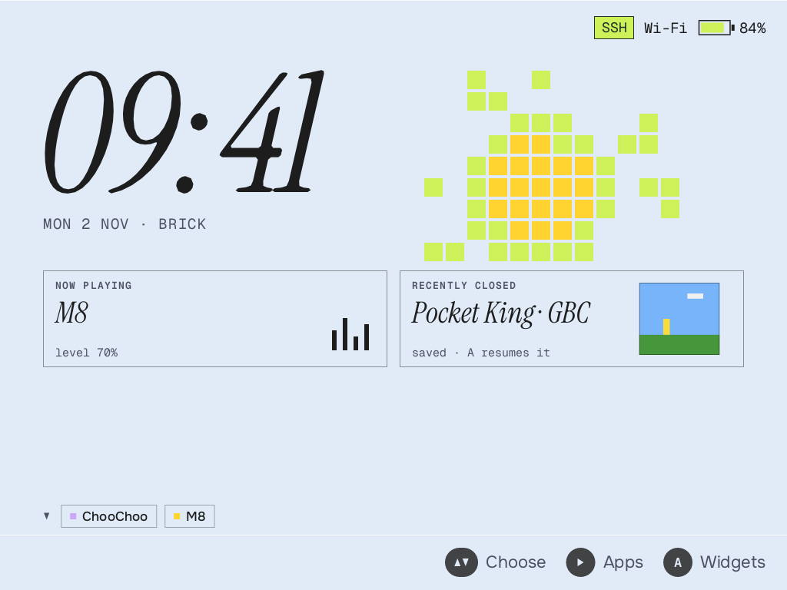</td>
    <td width="50%">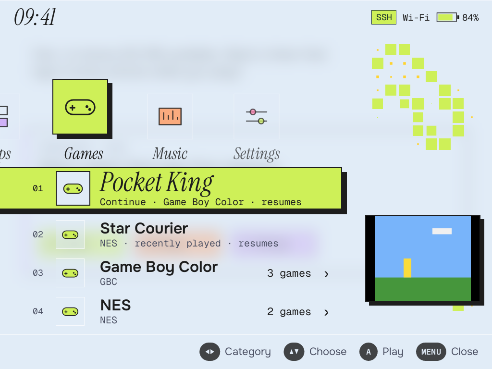</td>
  </tr>
  <tr>
    <td><b>Home</b>: a dashboard above your running apps, with widgets you can extend.</td>
    <td><b>Games</b>: every game is its own app, so switching and resuming work like anything else.</td>
  </tr>
  <tr>
    <td>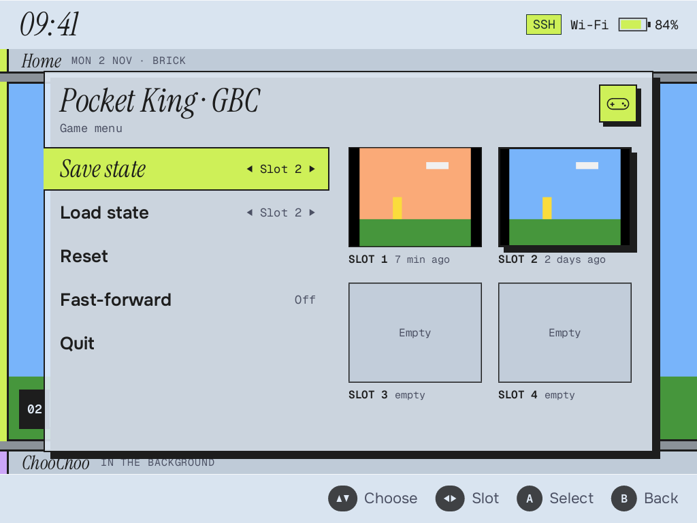</td>
    <td>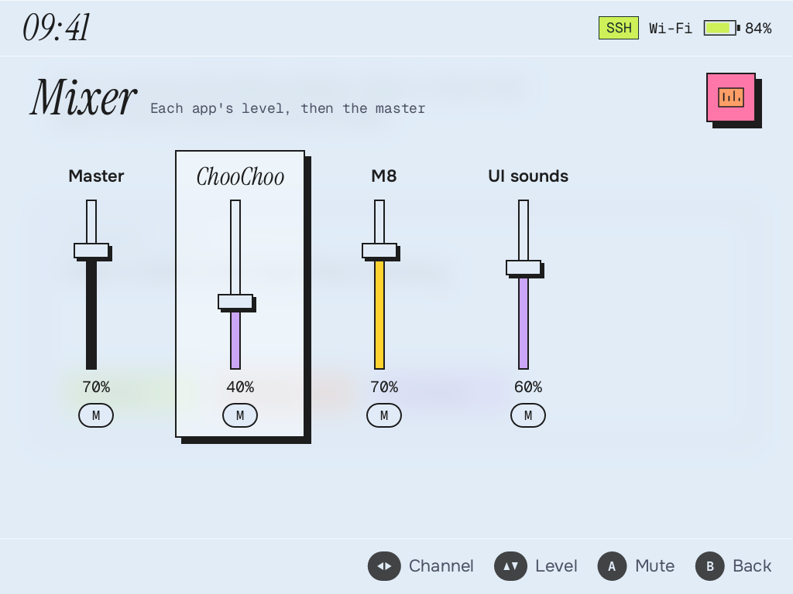</td>
  </tr>
  <tr>
    <td><b>In-game menu</b>: save states with thumbnails, one press of MENU away.</td>
    <td><b>Mixer</b>: a level for each app, so a tracker can play under a game.</td>
  </tr>
</table>

### Patterns

Home can show one of several small generative patterns. It runs for 45 seconds after you
last touch a button, then holds still, so it costs nothing when you aren't looking.

<table>
  <tr>
    <td width="33%">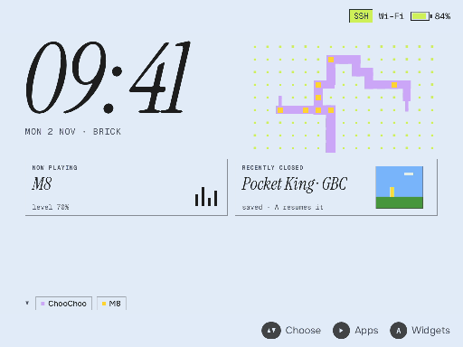</td>
    <td width="33%">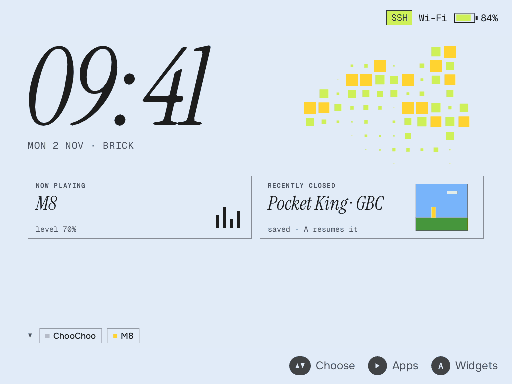</td>
    <td width="33%">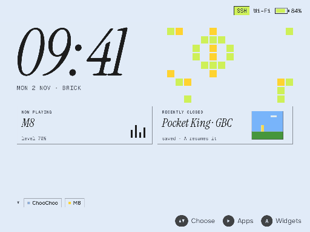</td>
  </tr>
  <tr>
    <td><b>River</b>: water carves a branching network into rough ground, then starts over.</td>
    <td><b>Boids</b>: a small flock that lights the tiles it crosses.</td>
    <td><b>Life</b>: Conway's Game of Life, reseeded so it never settles.</td>
  </tr>
</table>

Each menu category has its own pattern too, which grows across the screen as a screensaver:

<table>
  <tr>
    <td width="25%">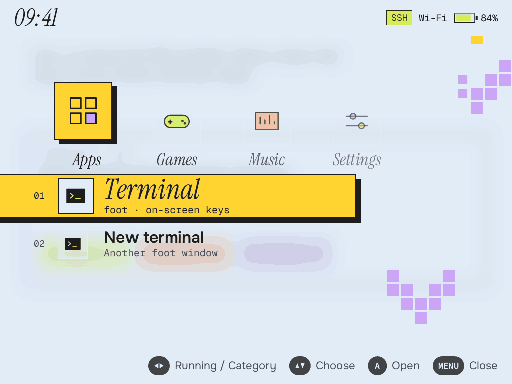</td>
    <td width="25%">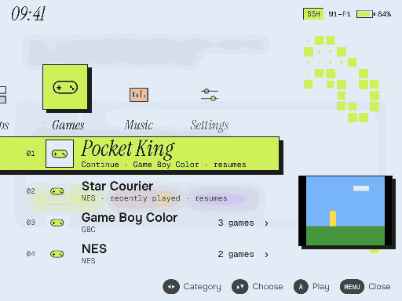</td>
    <td width="25%">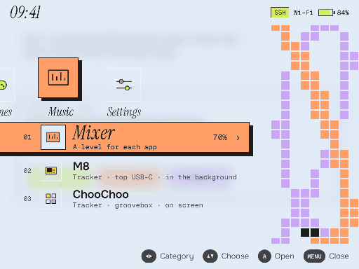</td>
    <td width="25%">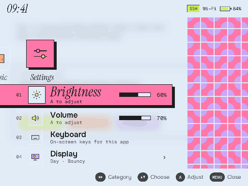</td>
  </tr>
  <tr><td>Apps</td><td>Games</td><td>Music</td><td>Settings</td></tr>
</table>

Screenshots and animations come from the shell's own preview renderer with sample data.

## Layers

| Layer | Where | Flake output | What |
|---|---|---|---|
| Hardware | `devices/brick/` (sources: `firmware/mainline`, `dtb`, `patches`, `pkgs/linux-trimui-brick.nix`, ...) | `nixosModules.brick` | Kernel, boot chain, firmware, GPU, PMIC, panel, radios, SD image. Works without the UI. |
| Core | `modules/core/`, `pkgs/mortar-*` | `nixosModules.core` | Shell, greeter, setup, pairing, power, updates, the session user, the `mortar` command. |
| Packs | `modules/packs/` | `nixosModules.pack-emulation`, `pack-music`, `pack-terminal`, `pack-ai` | mortar-play; m8c, ChooChoo, Little XM; zsh; Claude Code (optional, in no configuration here). Importing one turns it on. |
| Ports | `modules/ports/` | `nixosModules.port-pico8`, `port-acgc`, `port-puzzlescript` | Apps that need your own data. Each entry waits for it, or says where it goes. |
| Apps | `lib/mk-app.nix`, `pkgs/openxcom/app.nix` | `lib.mkApp`, `packages.*.openxcom` | A package with a manifest, in its own profile on the device: no system rebuild. |
| Systems | `configurations/` | `nixosConfigurations.brick-bare`, `brick-full` | Device + core only, or every pack and port that may be published. |

`modules/device.nix` is what the layers above ask of a device (`mortar.device`).

The hardware layer on its own is for bringing up a device, not for daily use: it
sets root's password to `trimui` and allows password SSH. Core locks that down, so
add your own SSH setup if you use the hardware layer without core. With core, a
computer on the USB cable can pair (with the code on the screen) and use SSH with a
key, and has no console; `mortar.usb.trustHost = true` opens that up for development
([docs/pairing.md](docs/pairing.md#what-a-usb-host-can-do)).

## Build a bare image

You need [Nix](https://nixos.org/download) with flakes and a way to build
`aarch64-linux` (a native machine, or on macOS `nixpkgs#darwin.linux-builder`).

```sh
nix build .#sd-image                 # bare; .#sd-image-full for all packs and ports
zstd -d result/sd-image/*.img.zst -o mortar.img
# write mortar.img to a microSD card (macOS helper: scripts/flash-mac.sh)
```

The build downloads TrimUI's public firmware release for its blobs. They are
proprietary, and no licence grants redistribution; because TrimUI publishes them, the
project has decided the bare image and cache may hold them. Three emulator cores have
non-commercial licences that allow free distribution, so they are published too, which
means **Mortar can't be sold and doesn't take donations** (`LICENSE`). Anything else
unfree, such as Claude Code, **must never be in a published image or a public cache**: a
system of your own with that stays private.
`mortar.unfree` lists what a system may use; see `docs/updates.md`.

After booting a system, change the configuration and:

```sh
nix run .#mortar -- pair                                # adds your SSH key
nix run .#mortar -- deploy --reboot --config brick-bare # --flake FLAKE for your own
```

## Your own system

```nix
{
  inputs.mortar.url = "github:gopherbone/mortar";

  outputs = { mortar, ... }: {
    nixosConfigurations.brick = mortar.lib.mkSystem {
      packs = [ mortar.nixosModules.pack-music ];
      ports = [ mortar.nixosModules.port-puzzlescript ];
      modules = [ ./my-apps.nix ];
    };
  };
}
```

Claude Code is in no configuration here. To have it on your own Brick:

```nix
modules = [
  mortar.nixosModules.full
  mortar.nixosModules.pack-ai
];
```

### Add a pack

A pack is a module under `modules/packs/`, exported in `flake.nix`. To use one, add
it to `packs` as above. Turn parts of one off with their options, such as
`mortar.apps.littlexm.enable = false`.

### Write your own app

An app is a launcher entry, usually in a small module of your own:

```nix
{ config, pkgs, ... }:

{
  mortar.shell.apps.htop = {
    name = "htop";
    icon = "gear";
    gamepad = "keyboard";
    order = 50;
    command = config.mortar.shell.terminal.command ++ [ "${pkgs.htop}/bin/htop" ];
  };
}
```

SDL apps that should use the GPU start through
`${config.mortar.device.sdlRun}/bin/mortar-sdl-run`. For an unfree package, add its
name to `mortar.unfree`. `modules/ports/puzzlescript.nix` is a short real example;
`mortar.shell.apps` in `modules/core/shell.nix` lists the options.

### Add an app without rebuilding the system

An app can also be a package with a manifest, in its own Nix profile on the device.
The shell watches `/nix/var/nix/profiles/apps` (`mortar.shell.appProfiles`), so the
entry shows when the profile appears and goes when it's removed:

```nix
packages.aarch64-linux.my-port = mortar.lib.mkApp pkgs {
  package = pkgs.callPackage ./my-port { };
  id = "my-port";
  name = "My Port";
  category = "games";
  gpu = true; # through mortar-sdl-run
  requires = [ "~/.local/share/my-port/data.bin" ]; # hidden until it's there
};
```

```sh
nix copy --no-check-sigs --to ssh-ng://root@mortar.local ./result
ssh root@mortar.local 'mkdir -p /nix/var/nix/profiles/apps &&
  nix-env -p /nix/var/nix/profiles/apps/my-port --set '"$(readlink result)"
```

Keep saves and data outside the profile, as `requires` above does, and removing it
(`rm -f /nix/var/nix/profiles/apps/my-port /nix/var/nix/profiles/apps/my-port-*-link`)
leaves them alone. The manifest format and the rules are in
`pkgs/mortar-shell/DESIGN.md`, "Apps in their own profiles". `pkgs/openxcom/app.nix` is
a real example; an entry in `mortar.shell.apps` with the same id wins over a manifest.

## Game data never goes in the repository

Not game files, disc images, firmware dumps or ROMs: not in this repository, nor the
Nix store, CI or a cache. Ports hold only the engine; your data goes straight to the
device (the store would make it world-readable and cacheable):

| Port | Your data | How |
|---|---|---|
| PICO-8 | your Raspberry Pi zip | `nix-store --add-fixed sha256 pico-8_0.2.7_raspi.zip`, then `mortar pico8` installs it in its own profile (see pkgs/pico8) |
| Animal Crossing | your disc image | `mortar acgc --iso PATH` |
| OpenXcom | your UFO: Enemy Unknown files | `mortar xcom --data PATH` installs the engine in its own profile and copies them (without `--data`, just the engine) |
| PuzzleScript | `.txt` games | copy to `~/.local/share/puzzlescript/games` |

Keep it that way in anything you contribute.

## What has and hasn't been tested

Tested on one Brick, by its owner: the full configuration with Claude Code added,
with all its apps (details and open items in
[docs/using.md](docs/using.md)). `brick-full` itself, without those, has not been
booted as such.

Built and evaluated, **never booted**: the bare system and its SD image. The
fresh-card path as a whole (write an image, first boot, grow the root partition,
setup, pair) has not been retested since the system stopped using an initrd, so treat
it as unproven. Keep your data elsewhere and expect to debug over the serial console.

Evaluated only: each pack and port on its own, a flake outside this repository using
`mkSystem`, and core with no device module. Over-the-air updates have a VM test
(`checks.*.mortar-update`) but have not been run on a device.

Apps in their own profiles (`lib.mkApp`, `mortar xcom`): unit tests, the shell's
headless backend in the build sandbox, and a VM with real profiles and garbage
collection (`checks.*.mortar-shell-discovery`, `checks.*.app-profiles`). `mortar xcom`
itself has only run against a stand-in for the device.

Only the Brick exists as a device. `modules/device.nix` is a first cut, and the shell
still assumes more than it covers: a 1024x768 panel and Brick button codes in Rust,
`gpio-vibrator` for rumble, `usb0` and `wlan0`, and the card name `Codec` when PipeWire
is off.

An earlier boot path (a vendor `boot0` chain and the tools for it, brittonr's work)
is gone from the tree; the git history keeps it. Mortar doesn't use it.

## Credits

- **jkingston**: the Linux 7.3 Brick port
  ([trimui-brick-kernel](https://github.com/jkingston/trimui-brick-kernel))
  and the mainline boot chain
  ([trimui-brick-firmware](https://github.com/jkingston/trimui-brick-firmware)),
  which Mortar builds on.
- **brittonr, adeci, murdoa**: the original NixOS on the Brick
  ([trimui-brick-nixos](https://github.com/brittonr/trimui-brick-nixos)),
  which this repository was forked from.
- Imagination Technologies, Allwinner and TrimUI for the GPU DDK and
  firmware; linux-sunxi and everyone upstreaming A133 support.
- Stephen Lavelle for [PuzzleScript](https://github.com/increpare/PuzzleScript):
  `pkgs/puzzlescript` derives from it, as an MIT-licensed port (see its README).
- laamaa (m8c), Lexaloffle (PICO-8), the libretro core authors, and
  Butterfly's Pond website for the visual inspiration. The Claude Spark is a
  trademark of Anthropic, used to label the Claude app.

## License

GPL-2.0-or-later for code in this repository (see `LICENSE`), except
`pkgs/puzzlescript`, which is MIT (its own `LICENSE`). Patches keep their upstream
licenses. The repository holds no vendor binaries; older commits do, and they are
covered by neither (see `LICENSE`). Builds fetch TrimUI's files at build time.
