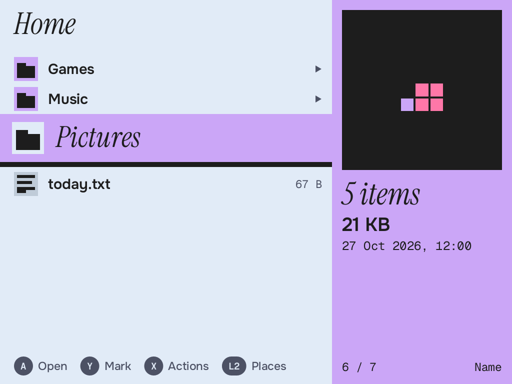
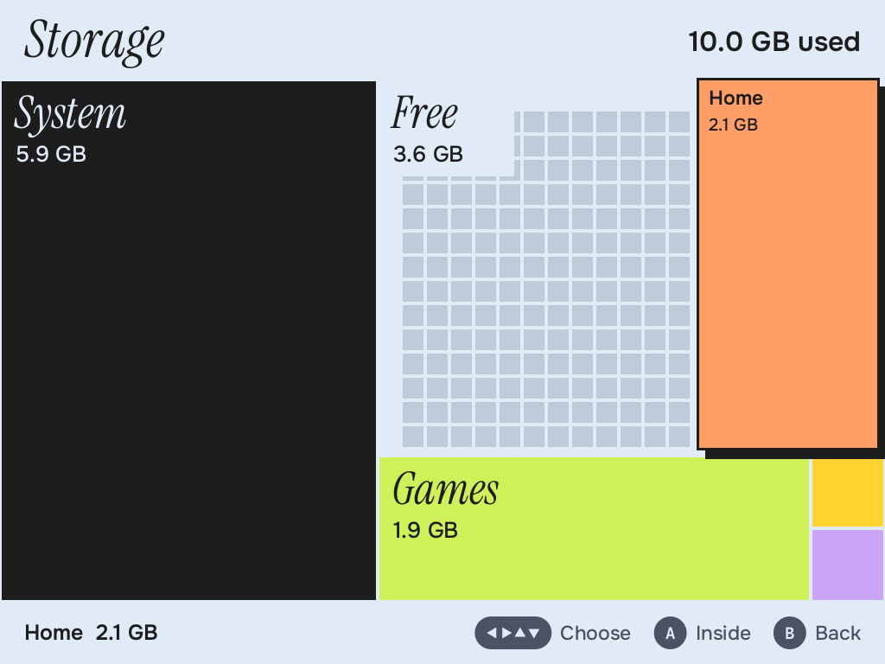
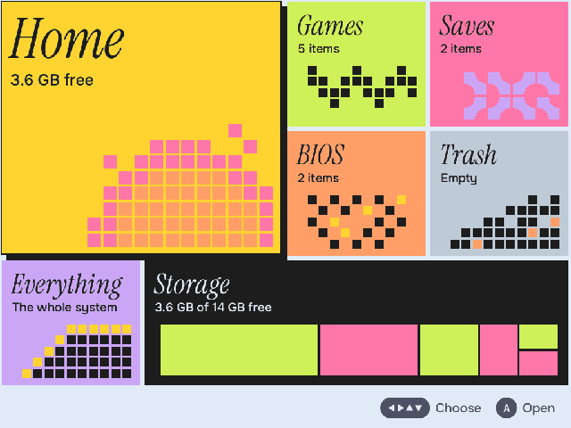

# Files

A file manager for the Brick's buttons, in the shell's language: solid colour,
mosaics of thick tiles, one screen at a time.

Screens are in `docs/` (`mortar-files preview --all DIR` makes them all).






## The design

**The band stays still and the list rolls under it.** With a D-pad you watch one
place: the selected row is always at the same height, its name in the 58 px
serif, on the shell's band from the screen's edge. Two rows show above it, six
below. Nothing has to be hunted for, and holding ▼ through thousands of entries
reads like a ticker rather than a jumping highlight.

**The band runs into the panel.** Band and panel are one shape in one colour: the
kind of the selected thing. Folder lavender, picture pink, game lime, save yellow,
sound and archive orange, text and everything else grey. Moving through a folder
changes the colour of a third of the screen, which is the fun, and tells you what
you're on before you read a word. There are no rules or outlines between things:
a solid block next to the ground needs none.

**The panel is a preview and three facts in large type**, with a 320 px square of
art on top:

| Selected | The square shows |
|---|---|
| Picture | The picture (PNG, JPEG; game screenshots scale by whole numbers) |
| Text | Its first lines |
| Folder | Its contents as a mosaic: a tile per thing in the kind's colour, spiralling from the middle, turned by the folder's name. Few things are a small figure, thousands fill the square, and each folder keeps its own look |
| Anything else | The file's first 121 bytes as tiles: text comes out one calm colour, compressed data as confetti, a zeroed header as a gap. It is the real data, so files of a format look alike and a damaged one looks wrong |

The rows carry a 6 x 6 glyph per kind and one value, whatever it's sorted by. The
size and the date are both in the panel, so no row needs a second line.

**Places, not a path.** It starts on a mosaic: Home large, then Games, Saves, BIOS,
any mounted card, Trash, Everything (`/`) and Storage. What doesn't exist isn't
listed. A title is the folder's name in the serif with its parents beside it in
26 px, counted from the place, so `Games ▸ nes` rather than a path.

**Copy is carrying.** Pick Copy or Move, and it's in your hand: a block by the title
says `Copying 3`, Y becomes *Put here*, and you walk to the destination the ordinary
way. There's no second browser or folder picker to learn.

**Storage is the mosaic the rest hints at.** A full-screen squarified treemap, a
tile per thing sized by the blocks it uses, in the colour of what it's mostly full
of. Free room is empty sockets. From Places it compares your folders against
System and Free without walking the Nix store; from a folder (SELECT) it adds up
that folder. The D-pad goes to the neighbouring tile, and A goes inside.

**Destructive screens fill the display** and use a colour nothing else does at
that size: yellow for the Trash, orange for gone for good. They name what, and how
many, with a tile for each thing.

## Buttons

The shell runs it in `keyboard` gamepad mode, the same as the terminal, so the pad
arrives as keys and START is the shell's keyboard. F1 and F2 have no key in that mode,
so nothing uses them. MENU is the shell's.

| Button | In a folder |
|---|---|
| ▲▼ | Move (held: repeats) |
| L1 R1 | A page |
| A, ▶ | Open (▶ only for folders) |
| B, ◀ | Up a folder; at a place's top, back to Places |
| Y | Mark and move on; with something in hand, put it here |
| X | Actions |
| L2 | Places |
| R2 | Next sort |
| SELECT | What's using the space here |
| START | Find by name (the shell's keyboard; a real keyboard just types) |

Opening a picture or text fills the screen. ◀▶ go through a folder's pictures, ▲▼
L1 R1 scroll text, B comes back. A game goes to the shell (`game SYSTEM PATH` on its
socket), so it's its own app in Running. Anything else says plainly that nothing
here can open it.

## Names

Naming uses the shell's on-screen keyboard rather than a second one: it's what the
terminal uses, a real keyboard works the same, and it's already drawn in the
style. The app sends `press start` on the shell's socket when a name is wanted, and
again when it's done. The shell then resizes the window, so the field sits above the
keys. The OSK's own mapping holds: Y is Enter, X is Space, B deletes. L2 walks away;
B on an empty field does too, but only on a fresh press, so holding B to clear a
name doesn't also leave. The cursor starts before the extension.

## Safety

`src/ops.rs` holds the rules, and they're tested against real folders
(`src/ops_tests.rs`).

- **Nothing is overwritten silently.** Final names are claimed with a no-replace
  rename. A clash stops the job and asks, with both sides shown and Skip first, so a
  stray A changes nothing. Replace is a plain atomic rename, only ever when answered.
  A file and a folder can't replace each other; two folders offer Merge.
- **Nothing half-done has a real name.** A file or a whole folder is built under a
  hidden `.mortar-part-*` beside its target, then renamed. A failure or a cancel
  removes the part. Sources are only read until the end.
- **A move across disks** is that copy, then `syncfs` of the destination, then the
  removal. If something couldn't come along (a socket, a FIFO) or the sync fails, the
  original stays, and the report says it's in both places.
- **Delete goes to the Trash first** (freedesktop `~/.local/share/Trash`, restorable
  with the original path and clash rules). It takes Y, while you got there with A,
  which here does nothing but point at Y. On another disk there's no Trash, and the
  screen says so.
- **Delete for good** takes L1 and R1 held together for 0.9 s, filling a row of
  tiles. Letting go, or the MENU opening, forgets it.
- **Links are objects.** Copied as links, trashed as links, removed as links; walks
  use lstat and d_type, and below the first level removal is std's `remove_dir_all`,
  which works through directory handles. A folder with a mount inside is refused.
- **Read-only places** (`/nix /proc /sys /dev /boot`, also through a link) are
  refused in the operations and not offered in the menu. So are `/`, top-level
  folders, what holds your home, and the places themselves.
- **Room is checked first**, and a shortage is refused before anything changes.
- **Errors are sentences** (`ops::plain`). A job carries on with the next thing after
  a failure and reports each one, saying what's still where it was.
- **Not atomic against other programs.** Something else writing to a file during a
  copy gets a copy of whatever was read.

## Weight

- **At rest it does nothing.** `poll()` with no timeout: no timers, no frames. The
  headless test counts 0 context switches in 5 s.
- **Previews wait** 120 ms on a selection and one decodes at a time, so holding ▼
  reads nothing. Images are decoded on a worker to the size they're drawn at, and 16
  are kept. PNGs over 24 MP are refused from their header; JPEGs decode at reduced
  scale.
- **A slide is two finished pictures moved**: a few memcpys a frame, one 190 ms ease.
  The list's roll is 110 ms of real draws. Both skip with Reduce motion, which is read
  from the shell's prefs at start, and a press cuts a slide short.
- **Behind other apps it doesn't draw**, even with a job running (the state of
  `activated`). A name clash while behind raises Needs you. Job progress wakes it at
  5 Hz.
- **Big folders** are read on a thread (cancelled when stale, capped at 200,000
  entries). A sort reads again rather than sort on the UI thread.
- Measured on an Apple core: a full list frame 0.29 ms, a slide frame 0.09 ms. The
  A53 will be several times that; not measured.

## Not here, on purpose

Tabs, two panes, bookmarks, thumbnails in rows, an association system, a text editor,
archive browsing. Zooming pictures. Scrollbars and minimaps: the panel says `14 / 238`.

## Pieces

```
src/ops.rs        copy, move, trash, restore, delete, rename; the guard
src/listing.rs    reading a folder, sorting, sizes, dates, kinds
src/preview.rs    what the panel shows; PNG, JPEG, text, folder summaries
src/storage.rs    the walk, the treemap, D-pad neighbours
src/places.rs     the places, mounted disks, what the emulator config says
src/mosaic.rs     glyphs, the folder and byte mosaics, the Places motifs
src/app.rs        state and buttons, no drawing and no window
src/view.rs       drawing, one function per screen; slides
src/keys.rs       key codes to buttons, as the shell sends them
src/shell.rs      the shell's socket: game, keyboard, Needs you
src/wl.rs         the window (Linux)
src/preview_cli.rs, src/demo.rs   the preview over a made-up tree
test.nix          the app in a headless shell, found by its manifest
```

## Tests

`cargo test` in this folder; the Nix build runs the same on Linux, where the
cross-disk tests get a real second filesystem (/dev/shm). `nix build
.#checks.aarch64-linux.mortar-files-headless` runs it in the shell's headless backend
with screenshots. To look at it, with `MORTAR_UI_FONTS` set to a folder of the fonts:

    mortar-files preview --list
    mortar-files preview --screen storage --out s.png [--theme dark]
    mortar-files preview --keys a,down,y,x --out s.png
    mortar-files preview --record a/16,down/5,x/14 --every 33 --outdir frames
