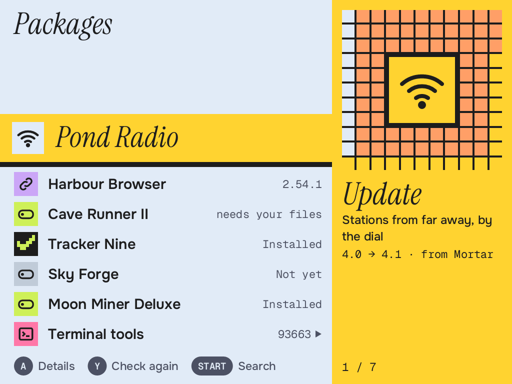
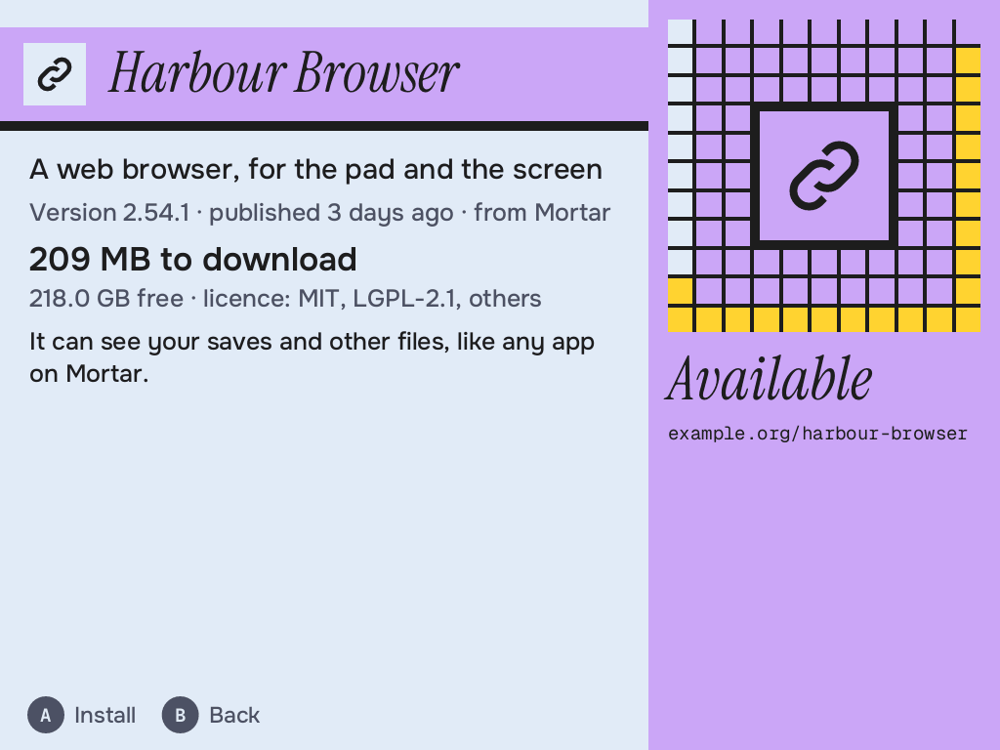
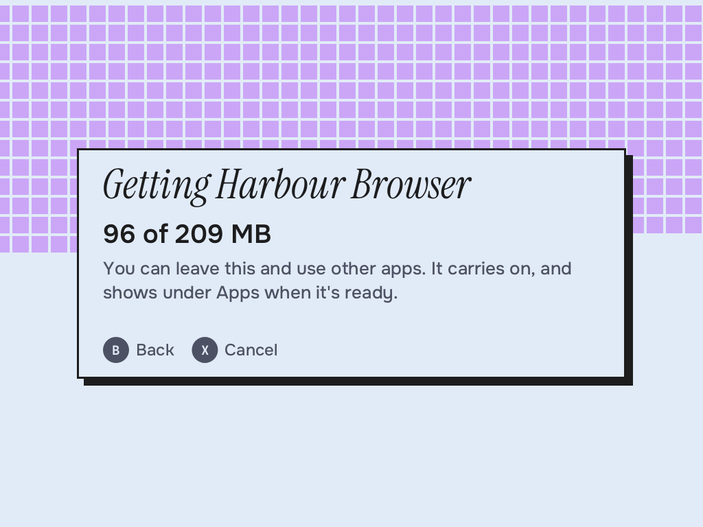
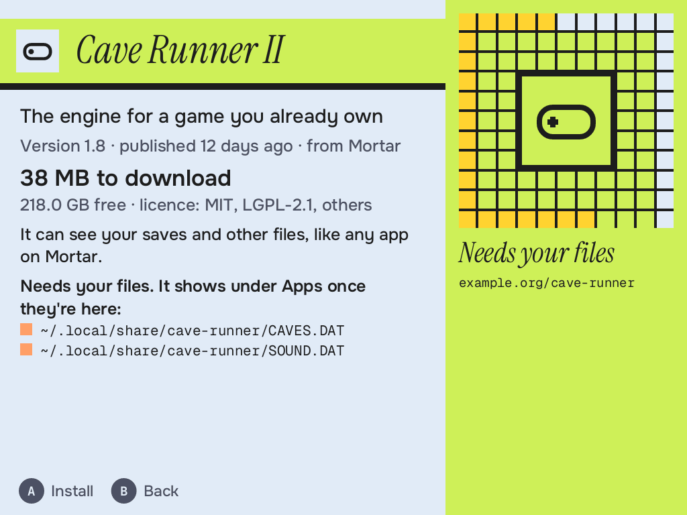
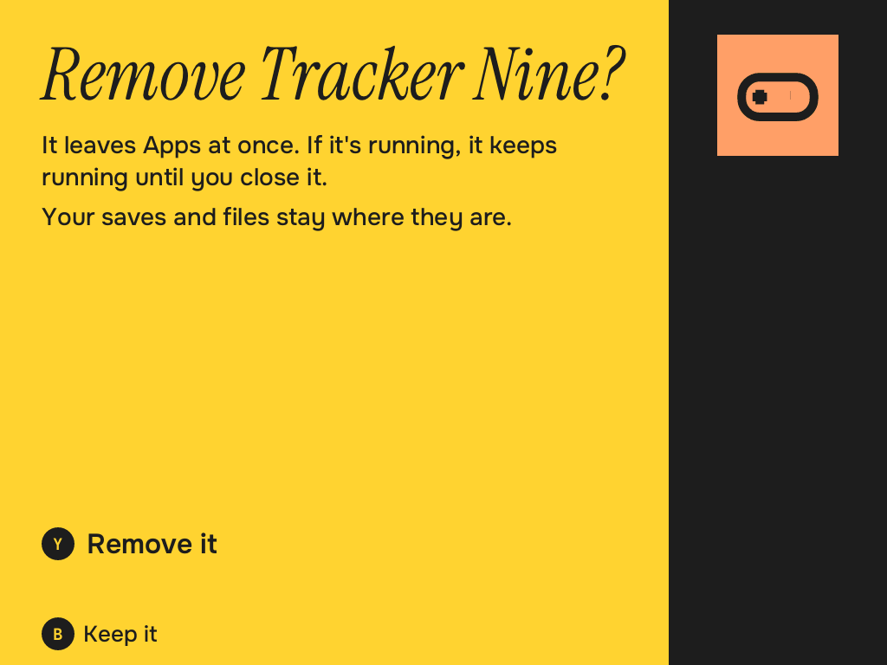
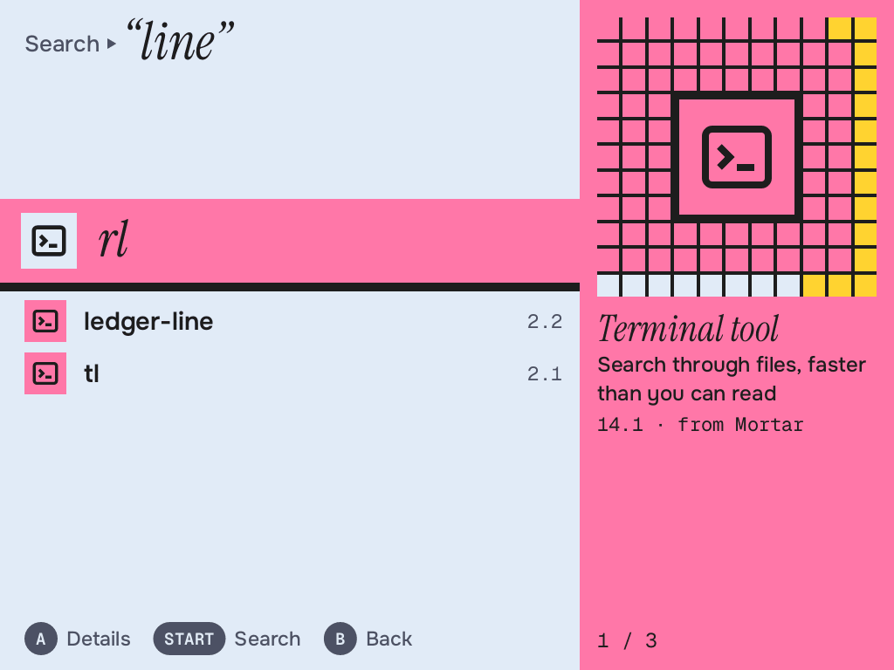

# Packages

Getting more for your Brick, with the pad and no computer: pick something, press A,
and it downloads in the background and shows up under Apps, with no system rebuild and
no restart. An app in Files' language, and a small root service behind it. The format
and the trust model are in [docs/packages.md](../../docs/packages.md).

Screens are in `docs/` (`mortar-packages preview --all DIR` makes them all, from made-up
packages).








## The design

**It's Files.** The same rolling band and panel, from the same code: the row you're on
stays at one height, in the 58 px serif, and the list rolls under it. Band and panel are
one shape in one colour, the kind of thing it is: app lavender, game lime, music orange,
terminal tool pink, yellow for an update waiting, grey for what can't be installed yet.

**The panel says where it stands.** A square of art, a mosaic seeded by the ID with the
package's icon on a plate, so each has its own look. Then a word (*Update*, *Installed*,
*Needs your files*), the description, the version and where it's from.

**A size is only shown once it's been asked for.** The design's list mock-up had a size
in the panel. It's a dry run of `nix-store`: a second or so, 26 MiB and some network, and
not worth it for a row that's only passing by. The details screen asks, and says what
this Brick is really missing, not the whole package.

**Details says what it can reach.** "It can see your saves and other files, like any app
on Mortar." Apps aren't sandboxed, so it says so before you install.

**Progress is the whole screen**, tiles lighting from the top, as Files' copy. B leaves it
running: it's the service's job, not the app's. The row in the list keeps counting,
coming back finds it, and closing the app doesn't stop it. X cancels. Nothing shows under
Apps until the last, atomic step, and that step can't be cancelled.

**Your own files.** An app that `requires` them says what's missing and where, with a tile
per file, and installs anyway: the shell hides it until they're there. Nothing here ever
touches them, or fetches them.

**Removing and rolling back are deliberate**, on Files' Trash screen: the whole display
in yellow, Y to do it, B to keep it, and A, the button that got you here, does nothing and
says so.

**Terminal tools** are their own list, the last row of the first one. Search is START, on
the shell's keyboard: Files' Find, asking the service after a pause. Tools go on Terminal's
path, not under Apps.

## Buttons

Keyboard gamepad mode, like Files, so the pad arrives as keys and START is the shell's
keyboard. MENU is the shell's.

| Button | |
|---|---|
| ▲▼ | Move (held: repeats) |
| L1 R1 | A page |
| A, ▶ | Details; on details Install, Update or Open |
| B, ◀ | Back; while it's installing, leave it running |
| X | On details: Remove. While it's installing: Cancel |
| Y | Check again; on details: Roll back |
| L2 | The first list |
| START | Search (a real keyboard just types) |

## The service

Writing to the Nix store takes root, and the app runs as the session user. So
`mortar-packagesd`, started on demand from `/run/mortar-packages/socket`, which only the
session user can reach (mode 0660, group `mortar-packages`).

- **Requests name a repository and a catalog ID.** Never a path or a URL. The fields are
  fixed and anything else is refused, so a misbehaving app can ask for the browser to be
  installed or removed, and can't add a source or install anything unsigned.
- **It exits when idle**, 20 s after the last thing it did, so it uses no memory when it
  isn't working. A connection per request, and one for as long as a job runs. An app at
  rest holds nothing open.
- **One job at a time.** A second one gets "One thing at a time". Remove and rollback
  answer at once, and collect garbage in the background with the service staying up for
  it.
- **Installing** reads the index afresh and checks it, checks the battery and the room,
  `nix-store --realise`s with that source's URLs and keys on the command line
  (`require-sigs`, `max-jobs 0`, `builders ""`: mortar-index's `nixargs`, shared with
  mortar-update), checks what arrived is what its kind needs, then `nix-env --set`s the
  profile. A root in `gcroots` holds the download until the profile does.
- **Updating** is the same, and the profile keeps one generation back. **Rolling back** goes
  to it, drops the newer one and remembers it, so the daily check doesn't undo it. Asking
  for the update still works.
- **The daily check** (`mortar-packages-auto`, right after `mortar-update-auto`) updates the
  official repository's packages while Auto-check is on. Others are only offered. Nothing
  running is interrupted: an app keeps what it started with.
- **It only touches what it installed.** A profile it has no record of (`mortar xcom`, say)
  shows as from elsewhere, and neither install nor remove will touch it.

## Weight

- **At rest it does nothing.** `poll()` with no timeout, from Files' window. The headless
  test counts context switches, CPU ticks and requests over 5 s at rest.
- **Progress wakes it at most 5 times a second**, only while a job runs, and it doesn't draw
  behind other apps.
- **A search** is 250 ms after the last letter, on a thread. The service streams the index
  through one 64 KiB buffer and keeps 50 hits (about 80 KB, counted by a test).

## Not here, on purpose

Bundles' runtime and sandbox (they're listed, and say not yet). Adding a repository: not
on any socket, and no screen for it yet. `mortar install`, `mortar repo publish`. A queue:
one job at a time, for now. Ratings, accounts, payments.

## Pieces

```
src/protocol.rs      the socket: requests, replies
src/service/         the root service
  server.rs            the socket, a thread per connection, exit when idle
  daemon.rs            what each request does; the install flow
  nix.rs               the Nix commands; dry runs and progress, read
  state.rs, config.rs  what's installed; /etc/mortar-packages/config.json
src/bin/mortar-packagesd.rs
src/app.rs           state and buttons, no drawing and no window
src/view.rs          drawing, one function per screen, with Files' helpers
src/backend.rs       who the app asks
src/demo.rs          a made-up service: previews, tests, `fake-service`
src/preview_cli.rs   the preview
test.nix             the app in a headless shell, against the made-up service
```

From `mortar-files`: the window (`wl`, as a `Client`), keys, the shell's socket, the wake
pipe, mosaics, and the view helpers.

## Tests

`cargo test` here. `nix build .#checks.aarch64-linux.mortar-packages` is the service on a
real store in VMs; `.#checks.aarch64-linux.mortar-packages-headless` is the app. To look at
it, with `MORTAR_UI_FONTS` set to a folder of the fonts:

    mortar-packages preview --list
    mortar-packages preview --screen details --out s.png [--theme dark]
    mortar-packages preview --keys down,a,a --out s.png
    mortar-packages preview --all DIR
